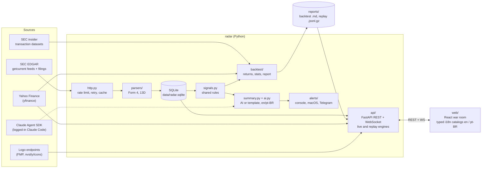

# radar-sec

**English** · [Português (Brasil)](README.pt-BR.md)

**radar-sec** (Radar SEC) watches what companies file with the SEC (EDGAR), flags insider buying
that looks meaningful, and measures, with a backtest that takes no shortcuts,
whether those signals would actually have made money.

It does four things:

1. **Monitors** EDGAR in near real time: Form 4 (insider purchases and sales) and Schedule 13D (someone crossed 5% of a company).
2. **Flags** three situations: several insiders buying together, a CEO or CFO making a large purchase, and a new significant shareholder.
3. **Measures** the outcome of those signals from 2020 to 2025 against SPY, with costs and limitations stated up front.
4. **Shows** everything on a real-time war-room dashboard designed to stay open on a monitor, in English or Brazilian Portuguese. See [Dashboard](#dashboard-war-room).


> **Honest verdict:** following these signals mechanically did **not** beat SPY between 2020 and 2025. See [Backtest result](#backtest-result).
>
> This is a research tool, not investment advice. Nothing here is a recommendation to buy or sell any security.

## Quickstart

Requires Python 3.13, [uv](https://docs.astral.sh/uv/) and [Node.js](https://nodejs.org) 20.19 or newer.

```bash
uv sync
cp .env.example .env      # then set SEC_USER_AGENT
./dev --replay            # historical replay, no SEC traffic needed beyond logos/prices
./dev                     # LIVE: polls the real SEC feeds
```

Open <http://localhost:5173>. `./dev` starts the API server (`uv run radar serve`) and the dashboard (`npm run dev` in `web/`) together and stops both on Ctrl+C. The first run installs the dashboard dependencies. Change the server port with `RADAR_PORT=8010 ./dev`; any extra option is passed to `radar serve`.

To run everything from a single process, without the dev server:

```bash
(cd web && npm install && npm run build)   # builds web/dist
uv run radar serve                         # API, WebSocket, collector and dashboard on http://localhost:8000
```

## Configuration

### `.env`

`.env` is never committed. Only one variable is required.

| Variable | Required | Purpose |
|---|---|---|
| `SEC_USER_AGENT` | **yes** | Identification required by the SEC, in the form `"Name contact@domain"`. Use your own name or project and an e-mail of yours. Without it, commands stop with an explanation. |
| `CLAUDE_CODE_OAUTH_TOKEN` | no | Only for AI summaries on a machine without a Claude Code login (see below). |
| `TELEGRAM_BOT_TOKEN` and `TELEGRAM_CHAT_ID` | no | With both set, alerts also go to Telegram. |
| `RADAR_ALERTS` | no | Comma-separated alert channels: `console`, `macos`, `telegram`. Default: `console`. |
| `RADAR_LANG` | no | Language for AI summaries, alerts and CLI output: `en` or `pt-BR`. Overrides `lang` in `radar.toml`. Default: `en`. |
| `RADAR_DATA_DIR` | no | Where the database and cache live. Default: `./data`. |
| `RADAR_CONFIG` | no | Parameters file. Default: `./radar.toml`. |

### `radar.toml`

All thresholds (signal rules, SEC rate limit, AI cap, backtest costs and filters) live in [`radar.toml`](radar.toml), with a comment on every key. The top-level `lang` key sets the language of AI summaries, alerts and CLI output (`en` by default, or `pt-BR`).

### AI summaries

Each signal gets a 3–5 line summary (who, how much, context). It is written by the [Claude Agent SDK](https://code.claude.com/docs/en/agent-sdk/python), which uses the Claude Code installation on your machine and **your own subscription**.

- **Nothing to configure.** Just be logged in to Claude Code: run `claude` and use `/login`.
- On a server or a machine without a login, create a token with `claude setup-token` and put it in `CLAUDE_CODE_OAUTH_TOKEN`.
- `ANTHROPIC_API_KEY` is **not used**. If it is in the environment, the radar removes it before calling the AI, so a call is never billed through the API.
- The subscription has a quota, so the AI is only called for signals that fire (never for every filing), once per filing and language (the summary is cached in SQLite), and capped at 30 calls per hour.
- Summaries are written in the configured `lang`. The dashboard shows the AI summary in that language and a deterministic template summary in the other one.
- If the AI fails for any reason (no login, quota exhausted, timeout), the template summary is used and the reason is logged. The system never depends on the AI: `--no-ai` turns it off.
- The backtest does not use AI.

## Commands

### `radar watch`

```bash
uv run radar watch --once          # one cycle: fetch, process, flag, alert
uv run radar watch --interval 60   # repeat every 60 seconds until Ctrl+C
```

Each cycle reads the EDGAR feeds, stores new filings (without duplicates), extracts their data, applies the rules and sends alerts. Useful options: `--alert console --alert macos` (channels for this run only), `--no-ai` (template summaries only), `--lang pt-BR` (language for this run) and `-v` (more logging).

The first run downloads a few hundred of the day's filings, which takes about a minute. After that each cycle only fetches what is new and takes a few seconds. When the radar sees an open-market purchase it also fetches the issuer's Form 4 filings from the last 44 days, so `cluster_buy` sees purchases made before the monitor was started.

### `radar signals`

```bash
uv run radar signals --since 7d                       # signals from the last 7 days
uv run radar signals --since 24h --type cluster_buy   # filter by type
uv run radar signals --since 2026-01-01 --full        # with the full summary
```

`--since` accepts `24h`, `7d`, `2w`, `3m` or a `YYYY-MM-DD` date.

### `radar backtest`

```bash
uv run radar backtest --start 2020-01-01 --end 2025-12-31
```

Downloads the SEC history, replays the rules and writes:

- `reports/backtest-<date>.md` — tables and verdict, in English;
- `reports/backtest-<date>.pt-BR.md` — the same report in Brazilian Portuguese;
- `reports/backtest-<date>-signals.csv` — one signal per row (not versioned, it is large);
- `reports/backtest-<date>-replay.jsonl.gz` — signals with details and outcome, for the dashboard REPLAY mode.

`radar backtest` always writes both reports; `--lang` only picks the language of its console output. The first run downloads about 350 MB from the SEC plus prices for about 3,000 tickers; it takes 15 to 40 minutes, depending on how much Yahoo throttles requests. Later runs use the cache and take a few minutes.

### `radar report`

```bash
uv run radar report                    # re-render both reports from the latest signals CSV
uv run radar report --lang pt-BR       # only the pt-BR report
```

Re-renders the Markdown reports from an existing signals CSV, using the cached SEC datasets and no price downloads. A CSV from the first (Portuguese) version is converted to the English columns.

### `radar serve` and `radar replay-build`

```bash
uv run radar serve                                   # LIVE
uv run radar serve --replay --replay-start 2022-01-03 --replay-speed 4
uv run radar serve --no-ai --interval 120 --port 8010
uv run radar replay-build                            # rebuild only the replay file from the latest backtest CSV
```

| Option | Purpose |
|---|---|
| `--replay` | Turns on REPLAY mode. |
| `--replay-start YYYY-MM-DD` | Replay start date. Default: 2020-02-18. |
| `--replay-speed N` | Simulated days per minute. Default: 2. |
| `--interval N` | LIVE: seconds between collection cycles. Default: 60. |
| `--alert channel` | LIVE: alert channel in addition to the dashboard (console, macos, telegram). |
| `--no-ai` | Template summaries only. |
| `--price-interval N` and `--no-prices` | Quote polling interval, or quotes off. |
| `--host` and `--port` | Where the server listens. Default: `127.0.0.1:8000`. |

The server has no authentication. It only listens on `127.0.0.1`; think twice before exposing it with `--host 0.0.0.0`.

## Dashboard (war room)

A full-screen, dark, dense screen, with signals arriving over WebSocket.

| Panel | Content |
|---|---|
| Top bar | LIVE or REPLAY badge, New York and Brasília clocks, market session, SPY, QQQ, IWM and VIX, and the state of the SEC collector, AI, WebSocket and prices. **EN / PT** toggle. |
| 01 Signals | One card per signal: logo, ticker, type, insiders (name, role and value), amount bought, score and sector. New signals enter at the top, highlighted. |
| 02 Signal in focus | Price chart with the filing day and the insider purchases marked, the average price paid, the summary (AI or template), the rule that fired and the company's purchase history. |
| 03 Buying radar | A radar scope by sector (each blip is a company, size is the amount bought, the rim is today) and the companies with the most buying in 7 or 30 days. |
| 04 What the backtest says | The report's verdict, with numbers by signal type, horizon and year. Always visible, so the operator doesn't fool themselves. |
| Tape | New filings (Form 4 and 13D) scrolling by, with the latest pinned on the left. |

The dashboard opens each new signal by itself. If you click another one, it waits two minutes before following new signals again (or click "Pinned" to resume right away). Arrow keys move through the signals.

**Language.** The dashboard is bilingual: English (default) and Brazilian Portuguese. The EN / PT toggle in the top bar switches everything live, including numbers, currency and dates (`$2.2M` / `Nov 18` vs `US$ 2,2 mi` / `18 nov`). The choice is remembered in the browser; the first visit follows the browser language.


### LIVE and REPLAY

- **LIVE** runs the same cycle as `radar watch` inside the server, every 60 seconds, and publishes each filing and signal as soon as it is processed. Red badge with a blinking light.
- **REPLAY** plays back the 9,018 backtest signals from 2020 to 2025, two simulated days per minute. It is meant for demos and to keep the room alive: real signals are few per day. Amber badge, a striped band at the top and the simulated date front and center. You can pause and speed it up from the dashboard.

In replay each signal carries the **outcome measured by the backtest**: the 1, 3 and 6 month return against SPY, or why it couldn't be measured. Panel 04 keeps a scoreboard of the signals replayed so far. The replay reads `reports/backtest-<date>-replay.jsonl.gz`, which is versioned (≈2.4 MB).

| LIVE | REPLAY (2560×1440) |
|---|---|
|  |  |

### API

| Route | Returns |
|---|---|
| `GET /api/health` | Mode and state of the collector, AI, prices and WebSocket. |
| `GET /api/state` | The same snapshot sent when a WebSocket connects. |
| `GET /api/signals?limit=&since=&type=` | Signals, newest first. |
| `GET /api/signals/{id}` | One signal with purchases, the company's previous signals and the chart range. |
| `GET /api/filings` | The latest filings, summarized. |
| `GET /api/company/{cik}` | A company's signals and purchases. |
| `GET /api/ranking?days=7` | Companies and sectors with the most buying in 7 or 30 days. |
| `GET /api/backtest` | Numbers from the latest backtest report. |
| `GET /api/quotes` | Latest quotes. |
| `GET /api/prices/{ticker}/history?start=&end=` | Daily bars. |
| `GET /api/logo/{ticker}` | The PNG logo, or 404. |
| `POST /api/replay/control` | REPLAY: `{"paused": true}`, `{"speed": 5}` or `{"seek": "2021-03-01"}`. |

The WebSocket lives at `/ws`. On connect the server sends a `snapshot` with everything the screen needs, then numbered events (`seq`): `signal.new`, `filing.new`, `price.tick`, `system.status`, `ranking.update` and `feed.reset`. The client reconnects on its own with exponential backoff and receives a fresh snapshot, so nothing is lost. The server sends codes (filing kinds, sectors, roles, states) and `{"en", "pt-BR"}` maps for generated text (explanations, summaries, verdict), so the dashboard can switch language without refetching.

## Architecture



The same rule functions run in the live monitor and in the backtest, so what the backtest measures is exactly what the monitor fires.

```
src/radar/
  cli.py            watch, signals, backtest, report, serve and replay-build commands
  config.py         .env and radar.toml
  i18n.py           language handling and lookups; catalogs in locales/ (en, pt_br)
  http.py           SEC client: User-Agent, rate limit, retry, cache
  feed.py           "getcurrent" Atom feed
  edgar.py          EDGAR submission (.txt) files
  parsers/          Form 4 (XML) and Schedule 13D (new XML and legacy HTML)
  signals.py        the three rules, shared by the monitor and the backtest
  db.py             SQLite: filings, transactions, signals, AI cache and usage, schema migrations
  ai.py             Claude Agent SDK call
  summary.py        AI summary, cache, hourly cap and template
  alerts/           console, macOS and Telegram
  watch.py          the monitor cycle
  backtest/         datasets, prices, returns, statistics, report and replay file
  sectors.py        issuer sector from the SIC code
  api/              dashboard server (REST, WebSocket, live and replay engines, prices, logos)
web/                dashboard (React, TypeScript, Vite)
tests/              offline tests, with real filings in tests/fixtures
dev                 starts server and dashboard together
```

To add an alert channel, write a class with `name` and `send(signal)` and register it with `radar.alerts.register("name", factory)`.

## The signals

| Signal | Rule |
|---|---|
| `cluster_buy` | At least 2 distinct insiders buy the same issuer's stock on the open market (code P) within 14 days, totaling at least $100K. |
| `big_officer_buy` | The CEO or CFO buys at least $250K on the open market in a single Form 4. |
| `activist_13d` | A new Schedule 13D (not an amendment) declares a stake of 5% or more. |

Details that change the result:

- **Only code P counts.** It is an open-market purchase with the insider's own money. Grants (A), option exercises (M), gifts (G), tax withholding (F) and other codes are stored but never fire a signal.
- **A signal is born on the filing date.** The signal date is the day the Form 4 reached the SEC, never the transaction date. The cluster looks at purchases from the previous 14 days, and only those already public.
- **"Distinct" means distinct.** A joint Form 4 (fund, manager and partner) counts as one insider. So do two Form 4s reporting the same transaction with the same resulting position.
- **Amendments don't count.** Form 4/A and 13D/A repeat information already disclosed.
- **30-day cooldown.** After firing, the same signal type doesn't repeat for the same issuer within that period.
- **Score from 0 to 100.** A heuristic to rank alerts (more insiders, larger value, CEO/CFO present, larger stake). The backtest report shows whether it relates to returns (it doesn't).

The 13D format changed in December 2024: since then it is structured XML, read field by field. For older filings, in HTML or text, the radar extracts what it can from the cover page (names and percentage) and says in the explanation that the data came from free text.

## Backtest result

Reference run: 2020-01-01 to 2025-12-31, default rules. Full report: [`reports/backtest-2026-11-18.md`](reports/backtest-2026-11-18.md) ([pt-BR](reports/backtest-2026-11-18.pt-BR.md)).

**The signals did not beat SPY.** The typical signal lost to the index at every horizon, and fewer than half of the signals ended above it.

| Signal | Horizon | Signals measured | Mean return | Median return | Mean excess vs SPY | Median excess vs SPY | Beats SPY |
|---|---|---|---|---|---|---|---|
| `cluster_buy` | 1 month | 4,903 | +0.8% | -0.1% | -0.7% | -1.7% | 43.6% |
| `cluster_buy` | 3 months | 4,903 | +6.3% | +2.2% | +0.7% | -3.1% | 42.9% |
| `cluster_buy` | 6 months | 4,903 | +9.8% | +2.4% | -0.0% | -6.5% | 40.6% |
| `big_officer_buy` | 1 month | 1,746 | +0.1% | +0.0% | -0.9% | -1.2% | 44.8% |
| `big_officer_buy` | 3 months | 1,746 | +5.0% | +1.1% | +0.5% | -3.1% | 43.5% |
| `big_officer_buy` | 6 months | 1,746 | +8.6% | +1.7% | -0.2% | -6.4% | 41.0% |

Returns are net of a 0.2% round-trip cost.

- **The signals made money, but the index made as much or more.** At 6 months the mean return was about 9%, practically the same as SPY over the same dates.
- **The mean is misleading.** Mean excess is near zero because a few stocks multiplied in value and offset the majority that lagged. The median, the typical case, is negative at every horizon (down to -6.5% at 6 months).
- **Nothing is statistically distinguishable from chance.** The highest t-stat by monthly cohort is 0.2; the bar for evidence would be 2.
- **Filtering for liquidity doesn't save it.** With price ≥ $5 and market cap ≥ $300M, the 6-month median excess stays negative: -4.3% for `cluster_buy` and -4.9% for `big_officer_buy`.
- **Same picture against small caps.** Swapping SPY for IWM, the 6-month mean excess goes to +0.7%, but the median stays at -5.3% and -4.6%.
- **It depends on the year.** 2020 was the only good year (+14% and +18% mean excess at 6 months, in the post-pandemic recovery). 2021 was the worst (-14% and -11%). From 2022 to 2025 the 6-month median excess was between -4% and -13%.
- **The score doesn't help.** High-score signals did not do better than low-score ones.
- **26% of the signals could not be measured** (2,369 of 9,018), mostly (1,459) because the ticker has no price on Yahoo, which usually means a delisted company. This is the largest uncertainty in the result.

Bottom line: following these signals mechanically, with these rules, did not justify the risk between 2020 and 2025. What the backtest doesn't rule out is that a more selective cut works; that would need out-of-sample validation.

### How each signal is measured

1. The signal becomes public on the filing date.
2. **Entry** at the close of the first trading day *after* that date.
3. **Exit** 1, 3 and 6 months later, at the close.
4. A 0.2% round-trip cost is subtracted.
5. **Excess** is that net return minus SPY's return over the same dates.

Read, in this order: **median excess** (the typical signal), **beats SPY** (share of signals with positive excess), **t (monthly cohort)** (above 2 is evidence), the **liquidity-filtered tables**, the **per-year breakdown** and the **data funnel** (how many signals went unmeasured and why).

## Data sources and terms

| Source | Used for | Terms |
|---|---|---|
| [SEC EDGAR](https://www.sec.gov/edgar) ("getcurrent" feeds, filing archives, company submissions) | Live monitoring, sectors | Public data. The radar follows the SEC [fair access policy](https://www.sec.gov/os/accessing-edgar-data): a declared `User-Agent`, at most 8 requests per second (the limit is 10), backoff on 429/5xx and a local cache so nothing is downloaded twice. |
| [SEC insider transactions data sets](https://www.sec.gov/data-research/sec-markets-data/insider-transactions-data-sets) | Backtest | Public data, same fair access policy. |
| [Yahoo Finance](https://finance.yahoo.com) via [yfinance](https://github.com/ranaroussi/yfinance) | Backtest prices, delayed dashboard quotes and charts | Unofficial API, not affiliated with Yahoo; data is for personal use under Yahoo's terms and comes with no guarantee. Quotes are delayed about 15 minutes. |
| [Financial Modeling Prep](https://financialmodelingprep.com) public image endpoint, with [nvstly/icons](https://github.com/nvstly/icons) as fallback | Company logos on the dashboard | Logos are trademarks of their owners, fetched on demand and cached locally (`data/cache/logos/`), never committed. Only the ticker is sent. |
| [Claude Agent SDK](https://code.claude.com/docs/en/agent-sdk/python) | Optional AI summaries | Runs on your own Claude Code login/subscription and its terms. |

## Limitations

The report lists all of them with the run's numbers. The main ones:

- **Survivorship bias.** Yahoo Finance keeps prices for almost no delisted companies. Signals on companies that went bankrupt or were acquired go unmeasured, and there is no way to know which case dominates.
- **Illiquid microcaps.** Much insider buying happens in small companies, where the spread costs far more than the assumed 0.2%.
- **Idealized execution.** Buys and sells exactly at the close, with no price impact and no size limit.
- **Hand-entered data.** Ticker, title and price are typed by the filer. Gross errors are filtered; subtle ones get through. CEO/CFO detection is based on the title text.
- **13D is not in the backtest.** The historical data sets cover only Forms 3/4/5.
- **Older 13Ds are read heuristically.** There was no XML before December 2024.
- **The monitor depends on the "getcurrent" feed**, which shows only the most recent filings. If the radar is off for days, what left the feed meanwhile is not recovered (except recent Form 4s of issuers with a new purchase).
- **Dashboard prices are delayed** about 15 minutes and come from a free source with no guarantee.
- **The live buying radar only sees what is in the database.** The 30-day window is incomplete until the monitor has run for 30 days; the dashboard shows since when the database has coverage.
- **Replay shows today's ticker and logo**, not the historical ones. Companies that left the SEC registry show a monogram and, usually, no chart.

## Tests

```bash
uv run pytest                                    # backend
uv run ruff check src tests                      # lint
(cd web && npm run lint && npm test && npm run build)   # dashboard
```

Tests never use the network, a login or a token. Parsers run against real filings saved in `tests/fixtures`; the monitor and the backtest run end to end with the SEC, Yahoo and the AI faked. The API and WebSocket are tested with fake price and logo sources, in both modes. In the dashboard, vitest covers state, WebSocket reconnection, locale-aware formatting, the language toggle and the main components. CI runs all of this on every push and pull request.

See [CONTRIBUTING.md](CONTRIBUTING.md).

## License

[MIT](LICENSE) © 2026 Jonatas Soares. Company logos, SEC data and Yahoo Finance data are not covered by this license and remain subject to their owners' terms (see [Data sources and terms](#data-sources-and-terms)).

## Disclaimer

radar-sec is a personal research project. It is **not investment advice**, not a recommendation to buy or sell any security, and not affiliated with the SEC, Yahoo, Financial Modeling Prep or Anthropic. Data may be delayed, incomplete or wrong. Past results, including the backtest above, do not predict future results. Do your own research and use it at your own risk.
