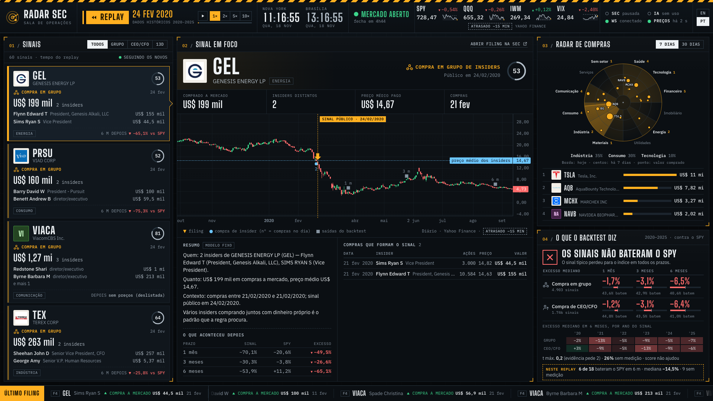
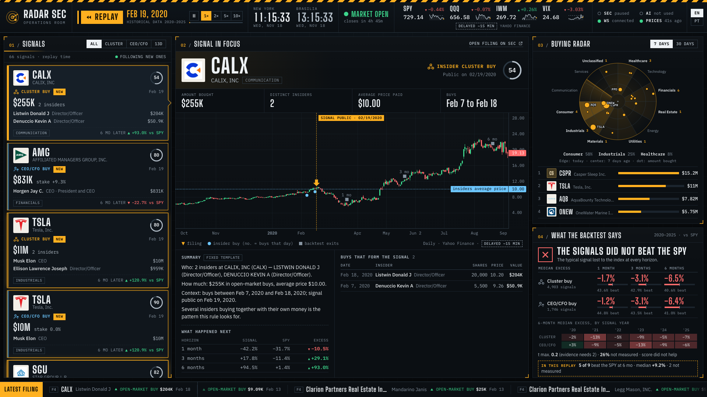
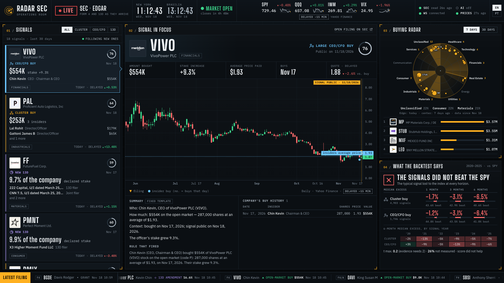
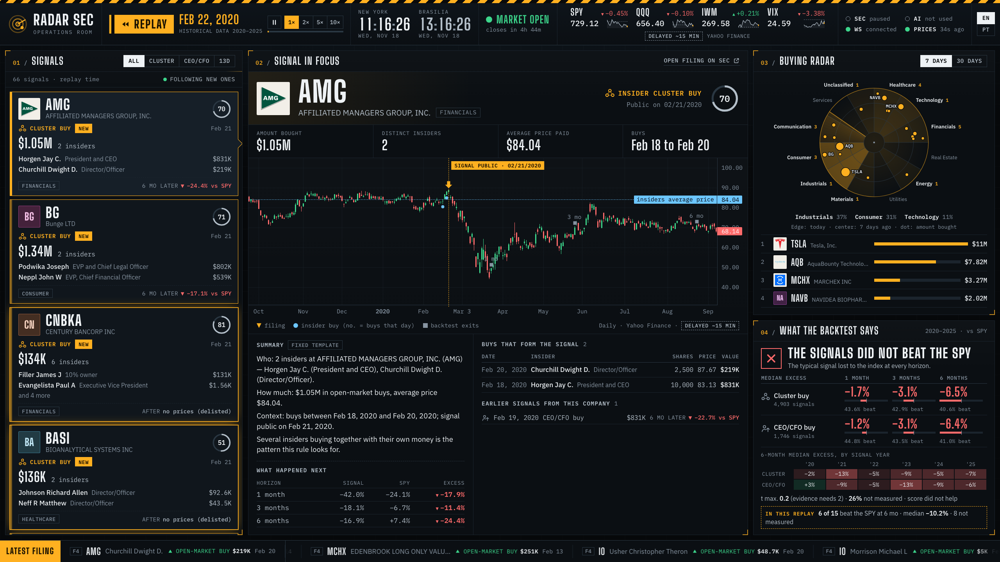
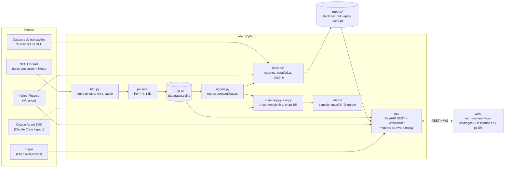
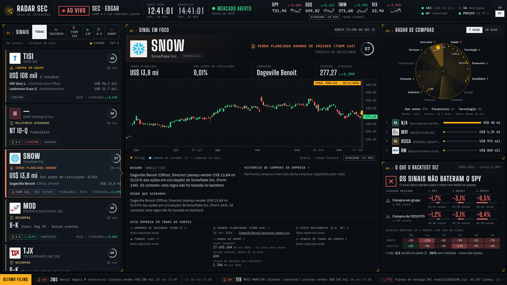

# radar-sec

[English](README.md) · **Português (Brasil)**

O **radar-sec** (Radar SEC) acompanha os documentos que as empresas arquivam na SEC (EDGAR), detecta compras relevantes por parte de quem conhece a empresa por dentro e mede, com um backtest sem atalhos, se esses sinais teriam dado retorno.

Ele faz quatro coisas:

1. **Monitora** o EDGAR em tempo quase real: Form 4 (compras e vendas de insiders) e Schedule 13D (alguém passou de 5% de uma empresa).
2. **Sinaliza** três situações: vários insiders comprando juntos, CEO ou CFO fazendo uma compra grande, e um novo acionista relevante.
3. **Mede** o resultado desses sinais de 2020 a 2025 contra o SPY, com custo e limitações declarados.
4. **Mostra** tudo em um painel de sala de operações (war room), em tempo real, feito para ficar aberto em um monitor, em inglês ou em português. Veja [Painel](#painel-war-room).



> **Veredito honesto:** seguir estes sinais mecanicamente **não** bateu o SPY entre 2020 e 2025, e nenhuma de dez variantes mais seletivas, tiradas da literatura, passou num teste fora da amostra pré-registrado. Veja [Resultado do backtest](#resultado-do-backtest) e [Pesquisa da fase 2](#pesquisa-da-fase-2).
>
> Isto é uma ferramenta de pesquisa, não uma recomendação de investimento. Nada aqui é recomendação de compra ou venda de qualquer ativo.

## Início rápido

Requer Python 3.13, [uv](https://docs.astral.sh/uv/) e [Node.js](https://nodejs.org) 20.19 ou mais novo.

```bash
uv sync
cp .env.example .env      # e edite o SEC_USER_AGENT
./dev --replay            # replay histórico, sem depender do feed da SEC
./dev                     # AO VIVO: coleta da SEC real
```

Abra <http://localhost:5173>. O `./dev` sobe o servidor (`uv run radar serve`) e o painel (`npm run dev` em `web/`) juntos e derruba os dois com Ctrl+C. Na primeira vez ele instala as dependências do painel. Para trocar a porta do servidor, use `RADAR_PORT=8010 ./dev`; qualquer opção extra vai para o `radar serve`.

Para rodar em um processo só, sem o servidor de desenvolvimento:

```bash
(cd web && npm install && npm run build)   # gera web/dist
uv run radar serve                         # API, WebSocket, coleta e painel em http://localhost:8000
```

## Configuração

### `.env`

O `.env` fica fora do git. Só uma variável é obrigatória.

| Variável | Obrigatória | Para quê |
|---|---|---|
| `SEC_USER_AGENT` | **sim** | Identificação exigida pela SEC, no formato `"Nome contato@dominio"`. Use o seu nome ou o do projeto e um e-mail seu. Sem ela, os comandos param com uma mensagem explicando. |
| `CLAUDE_CODE_OAUTH_TOKEN` | não | Só para rodar os resumos com IA em máquina sem login no Claude Code (veja abaixo). |
| `TELEGRAM_BOT_TOKEN` e `TELEGRAM_CHAT_ID` | não | Com as duas definidas, os alertas também vão para o Telegram. |
| `RADAR_ALERTS` | não | Canais de alerta separados por vírgula: `console`, `macos`, `telegram`. Padrão: `console`. |
| `RADAR_LANG` | não | Idioma dos resumos com IA, dos alertas e da saída da CLI: `en` ou `pt-BR`. Tem prioridade sobre o `lang` do `radar.toml`. Padrão: `en`. |
| `RADAR_DATA_DIR` | não | Onde guardar o banco e o cache. Padrão: `./data`. |
| `RADAR_CONFIG` | não | Arquivo de parâmetros. Padrão: `./radar.toml`. |

### `radar.toml`

Todos os limiares (regras dos sinais, ritmo de acesso à SEC, teto da IA, custos e filtros do backtest) ficam em [`radar.toml`](radar.toml), com um comentário em cada chave. A chave `lang`, no topo do arquivo, define o idioma dos resumos com IA, dos alertas e da saída da CLI (`en` por padrão, ou `pt-BR`).

### Resumo com IA

Cada sinal ganha um resumo de 3 a 5 linhas (quem, quanto, contexto). O resumo é gerado pelo [Claude Agent SDK](https://code.claude.com/docs/en/agent-sdk/python), que usa o Claude Code instalado na máquina e a **sua assinatura**.

- **Não precisa configurar nada.** Basta estar logado no Claude Code: rode `claude` e use `/login`.
- Em servidor ou máquina sem login, gere um token com `claude setup-token` e ponha em `CLAUDE_CODE_OAUTH_TOKEN`.
- `ANTHROPIC_API_KEY` **não é usada**. Se ela existir no ambiente, o radar a remove antes de chamar a IA, para a chamada nunca ser cobrada pela API.
- A assinatura tem cota, então a IA só é chamada para sinais disparados (nunca para cada filing), uma vez por filing e idioma (o resumo fica guardado no SQLite) e com teto de 30 chamadas por hora.
- O resumo sai no idioma configurado em `lang`. O painel mostra o resumo da IA nesse idioma e um resumo por modelo fixo no outro.
- Se a IA falhar por qualquer motivo (sem login, cota estourada, tempo esgotado), o resumo sai pelo modelo fixo e o motivo aparece no log. O sistema não depende da IA: `--no-ai` desliga de vez.
- O backtest não usa IA.

## Comandos

### `radar watch`

```bash
uv run radar watch --once          # um ciclo: busca, processa, sinaliza, alerta
uv run radar watch --interval 60   # repete a cada 60 segundos, até Ctrl+C
```

Cada ciclo lê os feeds do EDGAR, grava os filings novos (sem duplicar), extrai os dados, aplica as regras e dispara os alertas. Opções úteis: `--alert console --alert macos` (canais só para esta execução), `--no-ai` (resumo apenas por modelo fixo), `--lang pt-BR` (idioma desta execução) e `-v` (mais detalhes no log).

Na primeira execução o radar baixa algumas centenas de filings do dia, o que leva por volta de um minuto. Depois disso cada ciclo busca só o que chegou de novo e dura poucos segundos. Ao ver uma compra a mercado, o radar também busca os Form 4 dos últimos 44 dias do mesmo emissor; assim o `cluster_buy` enxerga compras feitas antes de o monitor ser ligado.

### `radar signals`

```bash
uv run radar signals --since 7d                       # sinais dos últimos 7 dias
uv run radar signals --since 24h --type cluster_buy   # filtra por tipo
uv run radar signals --since 2026-01-01 --full        # com o resumo completo
```

`--since` aceita `24h`, `7d`, `2w`, `3m` ou uma data `AAAA-MM-DD`.

### `radar backtest`

```bash
uv run radar backtest --start 2020-01-01 --end 2025-12-31
```

Baixa o histórico da SEC, reaplica as regras e gera:

- `reports/backtest-<data>.md`: tabelas e veredito, em inglês;
- `reports/backtest-<data>.pt-BR.md`: o mesmo relatório em português;
- `reports/backtest-<data>-signals.csv`: um sinal por linha (não é versionado, é grande);
- `reports/backtest-<data>-replay.jsonl.gz`: os sinais com detalhes e desfecho, para o modo REPLAY do painel.

O `radar backtest` sempre gera os dois relatórios; o `--lang` só escolhe o idioma da saída no terminal. A primeira execução baixa cerca de 350 MB da SEC e os preços de uns 3 mil tickers; leva de 15 a 40 minutos, dependendo de quanto o Yahoo segurar as requisições. As seguintes usam o cache e levam poucos minutos.

### `radar report`

```bash
uv run radar report                    # refaz os dois relatórios a partir do CSV de sinais mais recente
uv run radar report --lang pt-BR       # só o relatório em português
```

Refaz os relatórios em Markdown a partir de um CSV de sinais já gerado, usando os datasets da SEC em cache e sem baixar preços. Um CSV da primeira versão (colunas em português) é convertido para as colunas em inglês.

### `radar phase2`

```bash
uv run radar phase2 collect            # datasets e filings da SEC, preços (horas na primeira vez; retomável)
uv run radar phase2 run --split train  # 2020–2022: mede cada variante pré-registrada
uv run radar phase2 freeze --stake 0.2 --dip 0.3   # registra os parâmetros escolhidos no treino
uv run radar phase2 run --split test   # 2023–2025: não roda antes do congelamento
uv run radar phase2 report             # reports/phase2-<data>.md e o resumo .json do painel
```

A pesquisa por trás da [Pesquisa da fase 2](#pesquisa-da-fase-2). Tudo o que é intermediário fica em `data/phase2/`. `--prices tiingo` usa uma chave da Tiingo (`TIINGO_API_KEY`) no lugar do Yahoo; por padrão nenhuma chave é necessária.

### `radar serve` e `radar replay-build`

```bash
uv run radar serve                                   # AO VIVO
uv run radar serve --replay --replay-start 2022-01-03 --replay-speed 4
uv run radar serve --no-ai --interval 120 --port 8010
uv run radar replay-build                            # refaz só o arquivo de replay a partir do CSV mais recente
```

| Opção | Para quê |
|---|---|
| `--replay` | Liga o modo REPLAY. |
| `--replay-start AAAA-MM-DD` | Data inicial do replay. Padrão: 18/02/2020. |
| `--replay-speed N` | Dias simulados por minuto. Padrão: 2. |
| `--interval N` | AO VIVO: segundos entre ciclos de coleta. Padrão: 60. |
| `--alert canal` | AO VIVO: canal de alerta além do painel (console, macos, telegram). |
| `--no-ai` | Resumo só pelo modelo fixo. |
| `--price-interval N` e `--no-prices` | Frequência das cotações, ou cotações desligadas. |
| `--host` e `--port` | Onde o servidor escuta. Padrão: `127.0.0.1:8000`. |

O servidor não tem autenticação. Ele escuta só em `127.0.0.1`; pense duas vezes antes de expor com `--host 0.0.0.0`.

## Painel (war room)

Uma tela cheia, escura e densa, com os sinais chegando por WebSocket.

| Quadro | Conteúdo |
|---|---|
| Faixa superior | Selo AO VIVO ou REPLAY, relógios de Nova York e Brasília, estado do pregão, SPY, QQQ, IWM e VIX, e o estado da coleta da SEC, da IA, do WebSocket e dos preços. Seletor de idioma **EN / PT**. |
| 01 Sinais | Um cartão por sinal: logo, ticker, tipo, insiders (nome, cargo e valor), valor comprado, score e setor. O sinal novo entra no topo em destaque. |
| 02 Sinal em foco | Gráfico de preço com o dia do filing e as compras dos insiders marcados, o preço médio pago, o resumo (da IA ou do modelo fixo), a regra que disparou e o histórico de compras da empresa. |
| 03 Radar de compras | Visor de radar por setor (cada ponto é uma empresa, o tamanho é o valor comprado, a borda é hoje) e as empresas com mais compras em 7 ou 30 dias. |
| Fita | Os filings novos (Form 4 e 13D) passando, com o mais recente fixo à esquerda. |

O painel abre cada sinal novo sozinho. Se você clicar em outro, ele espera dois minutos antes de voltar a seguir os novos (ou clique em "Fixado" para voltar já). As setas para cima e para baixo percorrem os sinais.

**Small caps.** Os backtests só encontraram evidência para os filtros de *evitar* (atraso de balanço, venda a descoberto lotada, saída de CEO/CFO, troca de auditor, cluster e venda grande de Form 144, falhas de entrega persistentes, falência) em ações líquidas. Por isso, por padrão, esses sinais só aparecem quando o último preço da empresa é de pelo menos US$ 5 e o valor de mercado (preço × ações em circulação da capa do 10-Q/10-K) de pelo menos US$ 300 mi; empresa de tamanho desconhecido conta como pequena. "Mostrar small caps", no painel de sinais, revela o resto (a escolha fica guardada no navegador), e os cartões de evitar mostram preço e valor de mercado. Limites: `[dashboard]` no `radar.toml`. Sinais de compra e de contexto nunca são escondidos.

**Idioma.** O painel é bilíngue: inglês (padrão) e português do Brasil. O seletor EN / PT na faixa superior troca tudo na hora, inclusive números, moeda e datas (`US$ 2,2 mi` / `18 nov` em vez de `$2.2M` / `Nov 18`). A escolha fica guardada no navegador; na primeira visita vale o idioma do navegador.



### AO VIVO e REPLAY

- **AO VIVO** roda o mesmo ciclo do `radar watch` dentro do servidor, a cada 60 segundos, e publica cada filing e cada sinal assim que termina de tratá-lo. Selo vermelho com a luz piscando.
- **REPLAY** reproduz os 9.018 sinais do backtest de 2020 a 2025, dois dias simulados por minuto. Serve para demonstração e para a sala nunca ficar parada: sinais reais são poucos por dia. Selo âmbar, faixa zebrada no topo da tela e a data simulada em destaque. Dá para pausar e acelerar pelo próprio painel.

No replay cada sinal traz o **desfecho medido pelo backtest**: o retorno em 1, 3 e 6 meses contra o SPY, ou o motivo de não ter sido medido. O replay lê o arquivo `reports/backtest-<data>-replay.jsonl.gz`, que é versionado (≈2,4 MB).

| AO VIVO | REPLAY (2560×1440) |
|---|---|
|  |  |

### API

| Rota | Devolve |
|---|---|
| `GET /api/health` | Modo e estado da coleta, da IA, dos preços e do WebSocket. |
| `GET /api/state` | O mesmo snapshot enviado ao conectar no WebSocket. |
| `GET /api/signals?limit=&since=&type=` | Sinais, do mais recente para o mais antigo. |
| `GET /api/signals/{id}` | Um sinal com as compras, os sinais anteriores da empresa e o período do gráfico. |
| `GET /api/filings` | Os filings mais recentes, resumidos. |
| `GET /api/company/{cik}` | Sinais e compras de uma empresa. |
| `GET /api/ranking?days=7` | Empresas e setores com mais compras em 7 ou 30 dias. |
| `GET /api/backtest` | Os números do relatório de backtest mais recente. |
| `GET /api/quotes` | As últimas cotações. |
| `GET /api/prices/{ticker}/history?start=&end=` | Barras diárias. |
| `GET /api/logo/{ticker}` | O logo em PNG, ou 404. |
| `GET /api/events?limit=&source=` | Eventos das fontes extras (Form 144, 8-K, 13F, short). |
| `GET /api/company/{cik}/context` | Uma empresa em todas as fontes: sinais, compras de insiders, Form 144, 8-K, 13F e short. |
| `POST /api/replay/control` | REPLAY: `{"paused": true}`, `{"speed": 5}` ou `{"seek": "2021-03-01"}`. |

Os sinais AO VIVO também trazem `price`, `price_as_of`, `market_value`, `liquid` e `liquidity_gated` (sinal de evitar escondido por padrão se não for `liquid`). O preço vem do serviço de cotações (cache de 12 horas); as ações em circulação, da API "company concept" da SEC, no máximo uma vez por dia por empresa.

O WebSocket fica em `/ws`. Ao conectar, o servidor envia um `snapshot` com tudo o que a tela precisa; depois, eventos numerados (`seq`): `signal.new`, `filing.new`, `price.tick`, `system.status`, `ranking.update`, `feed.reset`, `market_event.new` (um evento das fontes extras) e `signals.update` (sinais já na tela com preço e valor de mercado novos). O cliente reconecta sozinho, com espera crescente, e recebe um snapshot novo: nada se perde. O servidor manda códigos (tipos de filing, setores, cargos, estados) e mapas `{"en", "pt-BR"}` para os textos gerados (explicações, resumos, veredito), e por isso o painel troca de idioma sem buscar nada de novo.

## Arquitetura



As mesmas funções de regra rodam no monitor e no backtest: o que o backtest mede é exatamente o que o monitor dispara.

```
src/radar/
  cli.py            comandos watch, signals, backtest, report, serve e replay-build
  config.py         .env e radar.toml
  i18n.py           idiomas e consulta aos catálogos em locales/ (en, pt_br)
  http.py           cliente da SEC: User-Agent, limite de taxa, retry, cache
  feed.py           feed Atom "getcurrent"
  edgar.py          arquivo de submissão (.txt) do EDGAR
  parsers/          Form 4 (XML) e Schedule 13D (XML novo e HTML antigo)
  signals.py        as três regras, usadas igualmente no monitor e no backtest
  db.py             SQLite: filings, transações, sinais, cache e uso da IA, migrações do esquema
  ai.py             chamada ao Claude Agent SDK
  summary.py        resumo com IA, cache, teto por hora e modelo fixo
  alerts/           console, macOS e Telegram
  watch.py          o ciclo do monitor
  backtest/         datasets, preços, retornos, estatísticas, relatório e arquivo de replay
  research/         fase 2: desfechos e fita de preços da SEC, fontes de preço, variantes,
                    texto do 10-K, carteiras de calendário, relatório (`radar phase2`)
  sectors.py        setor do emissor pelo código SIC
  sources/          fontes extras (form144, eightk, thirteenf, short): regras, histórico,
                    coletores ao vivo, tabelas, backtest e relatório dos novos sinais
  api/              servidor do painel (REST, WebSocket, motores ao vivo e replay, preços, logos)
web/                painel (React, TypeScript, Vite)
tests/              testes sem rede, com filings reais em tests/fixtures
dev                 sobe servidor e painel juntos
```

Para criar um canal de alerta, escreva uma classe com `name` e `send(signal)` e registre-a com `radar.alerts.register("nome", fabrica)`.

## Os sinais

| Sinal | Regra |
|---|---|
| `cluster_buy` | Pelo menos 2 insiders distintos compram a mercado (código P) ações do mesmo emissor dentro de 14 dias, somando ao menos US$ 100 mil. |
| `big_officer_buy` | O CEO ou o CFO compra a mercado ao menos US$ 250 mil em um único Form 4. |
| `activist_13d` | Um Schedule 13D novo (não emenda) declara participação de 5% ou mais. |

Detalhes que mudam o resultado:

- **Só o código P conta.** É a compra no mercado aberto com dinheiro próprio. Concessões (A), exercício de opções (M), doações (G), retenção para imposto (F) e os demais códigos são guardados no banco, mas não geram sinal.
- **O sinal nasce no arquivamento.** A data do sinal é o dia em que o Form 4 chegou à SEC, nunca o dia da transação. O cluster olha as compras feitas nos 14 dias anteriores, e só as que já estavam públicas.
- **"Distintos" é para valer.** Um Form 4 conjunto (fundo, gestora e sócio) conta como um insider. Dois Form 4 que relatam a mesma transação com a mesma posição final também.
- **Emendas não contam.** Form 4/A e 13D/A repetem informação já divulgada.
- **Fundos ficam de fora.** `cluster_buy` e `big_officer_buy` ignoram fundos fechados e veículos parecidos: conselheiros e gestora comprando cotas do fundo não é uma aposta de insider no negócio. Um emissor é fundo quando o SIC (do cadastro da SEC) é 6722 ou 6726 (escritórios de investimento; 6798, REITs, continua) ou quando não tem SIC (fundos registrados como o BNY Mellon Strategic Municipals aparecem com `0000`) e entrega relatórios de fundo registrado (N-CSR, NPORT-P, N-CEN...). Sem resposta do cadastro, decide uma heurística de nome bem restrita ("Municipal Income Fund", "Credit Trust"). BDCs entregam 10-Q e continuam. A mesma regra vale ao vivo, no backtest e no painel (sinais de fundos já gravados ficam escondidos, não apagados). Ajustes: `exclude_funds`, `fund_sic_codes` e `fund_name_heuristic` em `[signals]`.
- **Cooldown de 30 dias.** Depois de disparar, o mesmo tipo de sinal não repete para o mesmo emissor nesse período.
- **Score de 0 a 100.** É uma heurística para ordenar os alertas (mais insiders, valor maior, presença de CEO/CFO, participação maior). O relatório do backtest mostra se ele tem relação com o retorno (não tem).

O 13D mudou de formato em dezembro de 2024: desde então é XML estruturado, lido campo a campo. Para os anteriores, em HTML ou texto, o radar extrai o que consegue da capa (nomes e percentual) e avisa na explicação que o dado veio de texto livre.

## Resultado do backtest

Execução de referência: 2020-01-01 a 2025-12-31, com as regras padrão. Ela é anterior à exclusão de fundos e não foi refeita: o próximo `radar backtest` (ou `radar report`, que tira as linhas de fundos de um CSV existente) lista no funil dos dados os sinais excluídos. Relatório completo: [`reports/backtest-2026-11-18.pt-BR.md`](reports/backtest-2026-11-18.pt-BR.md) ([em inglês](reports/backtest-2026-11-18.md)).

**Os sinais não bateram o SPY.** O sinal típico perdeu para o índice em todos os prazos, e menos da metade dos sinais ficou acima dele.

| Sinal | Prazo | Sinais medidos | Retorno médio | Retorno mediano | Excesso médio vs SPY | Excesso mediano vs SPY | Bate o SPY |
|---|---|---|---|---|---|---|---|
| `cluster_buy` | 1 mês | 4.903 | +0,8% | -0,1% | -0,7% | -1,7% | 43,6% |
| `cluster_buy` | 3 meses | 4.903 | +6,3% | +2,2% | +0,7% | -3,1% | 42,9% |
| `cluster_buy` | 6 meses | 4.903 | +9,8% | +2,4% | -0,0% | -6,5% | 40,6% |
| `big_officer_buy` | 1 mês | 1.746 | +0,1% | +0,0% | -0,9% | -1,2% | 44,8% |
| `big_officer_buy` | 3 meses | 1.746 | +5,0% | +1,1% | +0,5% | -3,1% | 43,5% |
| `big_officer_buy` | 6 meses | 1.746 | +8,6% | +1,7% | -0,2% | -6,4% | 41,0% |

Retornos já com o custo de 0,2% descontado.

- **Os sinais ganharam dinheiro, mas o índice ganhou igual ou mais.** Em 6 meses o retorno médio foi de cerca de 9%, praticamente o mesmo do SPY nas mesmas datas.
- **A média engana.** O excesso médio fica perto de zero porque poucos papéis multiplicaram de valor e compensaram a maioria que ficou para trás. A mediana, que mostra o caso típico, é negativa em todos os prazos (até -6,5% em 6 meses).
- **Nada é estatisticamente distinguível de acaso.** O maior t por safra mensal é 0,2; o mínimo para falar em evidência seria 2.
- **Filtrar liquidez não salva.** Com preço ≥ US$ 5 e valor de mercado ≥ US$ 300 mi, o excesso mediano em 6 meses continua negativo: -4,3% no `cluster_buy` e -4,9% no `big_officer_buy`.
- **Contra small caps o quadro é o mesmo.** Trocando o SPY pelo IWM, o excesso médio em 6 meses vai a +0,7%, mas o mediano segue em -5,3% e -4,6%.
- **Depende do ano.** 2020 foi o único ano bom (excesso médio de +14% e +18% em 6 meses, na recuperação pós-pandemia). 2021 foi o pior (-14% e -11%). De 2022 a 2025 o excesso mediano em 6 meses ficou entre -4% e -13%.
- **O score não ajuda.** Sinais de score alto não renderam mais que os de score baixo.
- **26% dos sinais ficaram sem medição** (2.369 de 9.018). A maior parte (1.459) por ticker sem preço no Yahoo, o que em geral significa empresa deslistada. É a maior incerteza do resultado.

Conclusão prática: seguir estes sinais mecanicamente, com estas regras, não justificou o risco entre 2020 e 2025. A fase 2 (abaixo) testou recortes mais seletivos fora da amostra e trouxe de volta as empresas deslistadas: nada mudou a conclusão.

## Pesquisa da fase 2

Plano pré-registrado: [`research/phase2-plan.md`](research/phase2-plan.md) (commitado, com adendos datados, antes do teste). Relatório completo, em inglês: [`reports/phase2-2026-11-18.md`](reports/phase2-2026-11-18.md).

**Método.** Regras e os dois parâmetros livres foram escolhidos nos sinais de 2020–2022 (treino), congelados e rodados uma única vez em 2023–2025 (teste). Cada variante é medida por sinal e como carteira de calendário equal-weight (cada sinal fica 3 meses), com t de Newey-West e alfa contra SPY e IWM, custo de 0,2% ida e volta (1% abaixo de US$ 5). Uma variante passa só se, no teste, o excesso mediano for positivo e o t da carteira mensal for ≥ 2 **contra SPY e contra IWM**.

**Correção de sobrevivência, sem dados pagos.** Para os sinais que o Yahoo não precifica, os próprios filings da empresa na SEC dizem o que aconteceu (Form 25 e 15, proxies de fusão e ofertas públicas, itens 1.03, 2.01 e 5.01 do 8-K), e os preços dos Form 4 servem de fita de preços gratuita (erro mediano de cerca de 1% contra o Yahoo). Os sinais da fase 1 medidos passaram de 74% para 83%. As empresas que voltaram foram **pior** que as demais (excesso mediano em 3 meses de −6,4% contra o SPY): a correção deixa o veredito da fase 1 um pouco mais negativo, não menos.

**Resultado (teste, 3 meses): nenhuma variante passou.**

| Variante | Ideia | Excesso mediano vs SPY / IWM | t da carteira vs SPY / IWM | Veredito |
|---|---|---|---|---|
| `insider_buy` | compra a mercado de diretor ou executivo ≥ US$ 50 mil (a base) | −4,1% / −2,7% | −0,8 / 0,7 | descartar |
| `opportunistic_buy` | insiders "oportunistas" de Cohen, Malloy e Pomorski | −3,3% / −1,6% | −0,4 / 0,9 | descartar |
| `first_buy` | primeira compra em 24 meses | −3,6% / −2,6% | −1,6 / −1,0 | descartar |
| `stake_jump` | posição sobe ≥ 20% | −4,3% / −3,2% | −1,3 / −0,4 | descartar |
| `dip_buy` | ação caiu ≥ 30% em 3 meses | −4,4% / −4,0% | 0,0 / 0,6 | descartar |
| `csuite_cluster` | CEO e CFO (ou 3 executivos) comprando em 14 dias | −3,5% / −2,2% | −0,5 / 0,7 | descartar |
| `opportunistic_dip`, `first_big_stake` | combinações | −1,7% a −4,1% | −1,9 a −0,6 | descartar |
| `lazy_nonchangers` | 10-K quase igual ao do ano anterior ("Lazy Prices") | −6,2% / −0,9% | −3,0 / −1,5 | descartar |
| `insider_buy_text_ok` | compra de insider, 10-K fora do quintil que mais mudou | −2,9% / −1,6% | −0,7 / 1,0 | descartar |
| `cluster_buy` (fase 1) | sem mudança | −4,3% / −3,1% | −1,6 / −0,6 | descartar |
| `big_officer_buy` (fase 1) | sem mudança | −4,5% / −2,3% | −0,3 / 2,3 | descartar |

O caso mais próximo, `big_officer_buy`, bateu o IWM em 0,5% ao mês (t 2,3), mas perdeu para o SPY e o sinal típico perdeu para os dois; no treino também foi negativo. O sinal de texto do 10-K inverteu entre treino e teste. Como nenhuma variante passou, **nenhum tipo de sinal novo entrou no monitor ao vivo**; o veredito completo está em [`reports/phase2-2026-11-18.md`](reports/phase2-2026-11-18.md). Um estudo de viabilidade para o Brasil (dados da CVM/B3) está em [`research/b3-feasibility.md`](research/b3-feasibility.md).

### Como cada sinal é medido

1. O sinal fica público na data de arquivamento.
2. **Entrada** no fechamento do primeiro pregão *depois* dessa data.
3. **Saída** 1, 3 e 6 meses depois, no fechamento.
4. Do retorno sai o custo de 0,2% (ida e volta).
5. O **excesso** é esse retorno líquido menos o retorno do SPY nas mesmas datas.

O que olhar, nesta ordem: **excesso mediano** (o sinal típico), **bate SPY** (fração dos sinais com excesso positivo), **t (safra mensal)** (acima de 2 é evidência), as **tabelas filtradas por liquidez**, a **quebra por ano** e o **funil dos dados** (quantos sinais ficaram sem medição e por quê).

## Fontes extras de sinal

Além do Form 4 e do 13D, o radar acompanha mais quatro fontes públicas e gratuitas. Cada uma
fica em `src/radar/sources/<fonte>/` com as mesmas partes (parser, regras puras usadas igualmente
ao vivo e no backtest, histórico sem olhar o futuro, coletor ao vivo) e aparece no painel com
chips, cartões, eventos na fita e contexto da empresa.

| Fonte | O que acompanha | Sinais | Ritmo ao vivo |
|---|---|---|---|
| **Form 144** | Avisos de venda planejada de afiliados (eletrônico desde 2023-04) | `form144_cluster` (3+ vendedores em 10 dias), `form144_large` (≥ US$ 10 mi ou ≥ 1% das ações; contexto, não testado) | todo ciclo |
| **8-K / NT** | Fatos relevantes classificados pelo item do EDGAR; avisos de atraso | `buyback_8k`, `ceo_cfo_exit_8k` (5.02), `bankruptcy_8k` (1.03), `auditor_change_8k` (4.01), `late_filing_nt`; acordos de fusão, aquisições concluídas e divulgação de resultado como contexto | todo ciclo (NT a cada 15 min) |
| **13F** | Carteiras trimestrais de gestores com mais de US$ 100 mi | `fund_consensus_13f` (alcance da posse, datado no prazo de 45 dias), `notable_fund_new_13f` (posições novas de uma lista fixa de gestores) | a cada 15 min; consenso depois de cada prazo |
| **Short** | Short interest e volume vendido diário da FINRA, falhas de entrega da SEC | `short_crowded`, `squeeze_setup`, `ftd_persistent`; volume vendido como contexto | verificação de hora em hora |

Negociações de parlamentares dos EUA (Câmara e Senado, STOCK Act) e calendários de eventos (fim
de lockup, datas de resultado) foram avaliados e **ficaram de fora**: as operações estão em PDFs de
layout livre, o site do Senado exige sessão automatizada e não há calendário estruturado gratuito.
O raciocínio está em [`research/new-signals-plan.md`](research/new-signals-plan.md).

```bash
uv run radar backtest-sources                 # reports/new-signals-<data>.md e .pt-BR.md
```

Regras, períodos (treino 2020–2022, teste 2023–2025) e critérios de veredito foram fixados no
plano **antes** de qualquer backtest. Mesmo motor de preços e mesmos índices do backtest de
insiders; custo de 0,2% ida e volta, 1% abaixo de US$ 5. Veredito no prazo principal, período de
teste, excesso sobre o SPY (relatório completo:
[`reports/new-signals-2026-11-18.pt-BR.md`](reports/new-signals-2026-11-18.pt-BR.md)):

| Sinal | Hipótese | N teste | Excesso médio / mediano | t | Veredito | Recorte líquido¹ |
|---|---|---|---|---|---|---|
| `buyback_8k` (6m) | bate | 1.276 | -4,2% / -5,9% | -3,5 | descartar | descartar |
| `ceo_cfo_exit_8k` (3m) | fica atrás | 508 | -6,2% / -13,6% | -1,0 | talvez (evitar) | talvez (evitar) |
| `bankruptcy_8k` (1m) | fica atrás | 54 | -30,4% / -38,9% | -3,0 | talvez (evitar) | dados insuficientes |
| `auditor_change_8k` (3m) | fica atrás | 1.860 | +160%² / -12,4% | 1,3 | descartar² | talvez (evitar) |
| `late_filing_nt` (3m) | fica atrás | 4.949 | +864%² / -16,9% | 1,2 | descartar² | **evitar** |
| `form144_cluster` (3m) | fica atrás | 6.130 | -1,0% / -3,7% | -0,9 | talvez (evitar) | talvez (evitar) |
| `fund_consensus_13f` (3m) | bate | 349 | +2,0% / -0,2% | 1,7 | descartar | talvez |
| `notable_fund_new_13f` (3m) | bate | 619 | -0,1% / -1,1% | 0,0 | descartar | descartar |
| `short_crowded` (1m) | fica atrás | 916 | -1,3% / -1,7% | -1,0 | talvez (evitar) | **evitar** |
| `squeeze_setup` (1m) | bate | 93 | -4,8% / -8,3% | -2,5 | descartar | dados insuficientes |
| `ftd_persistent` (1m) | fica atrás | 587 | -12,8% / -16,5% | -5,3 | talvez (evitar) | talvez (evitar) |

¹ Preço de entrada ≥ US$ 5 e valor de mercado ≥ US$ 300 mi: visão fixada no plano, não a base do
veredito. ² A média é dominada por cotações de balcão abaixo de um centavo (US$ 0,0001 que saltam
para dólares); a mediana é o número que importa. **Nenhum sinal novo chegou a "usar".** Os úteis
são filtros: relatório atrasado e short alto e subindo ficaram atrás do índice entre os papéis
líquidos; falhas de entrega, saída de CEO/CFO e falência ficaram muito atrás, mas sem treino
coerente ou significância. O viés de sobrevivência (o Yahoo quase não tem deslistadas) deixa todo
número de *evitar* menos negativo do que foi.



No painel: chips de fonte acima do feed de sinais (e, escolhida a fonte, chips de tipo), cartões
com selo da fonte, ícone e etiquetas em texto para a hipótese (**Evitar**, **Alta**) e para
**Não testado**, os eventos das fontes na fita e um bloco "esta empresa em todas as fontes" no
sinal em foco (compras de insiders, Form 144, 8-K, 13F, short interest, volume vendido e falhas).
Os resumos com IA cobrem os sinais novos dentro do mesmo teto por hora. Ligue ou desligue fontes
no `radar.toml` (`[sources] enabled`).

## Fontes de dados e termos de uso

| Fonte | Para quê | Termos |
|---|---|---|
| [SEC EDGAR](https://www.sec.gov/edgar) (feeds "getcurrent", arquivos dos filings, cadastro das empresas) | Monitoramento ao vivo, setores | Dados públicos. O radar segue a [política de acesso justo](https://www.sec.gov/os/accessing-edgar-data) da SEC: `User-Agent` declarado, no máximo 8 requisições por segundo (o teto é 10), espera crescente em 429/5xx e cache local para nada ser baixado duas vezes. |
| [Datasets de transações de insiders da SEC](https://www.sec.gov/data-research/sec-markets-data/insider-transactions-data-sets) | Backtest | Dados públicos, mesma política de acesso. |
| [Busca textual do EDGAR](https://efts.sec.gov/LATEST/search-index) e conjuntos de dados da SEC de [13F](https://www.sec.gov/data-research/sec-markets-data/form-13f-data-sets) e [falhas de entrega](https://www.sec.gov/data-research/sec-markets-data/fails-deliver-data) | Fontes extras: histórico e ao vivo | Dados públicos, mesma política de acesso e mesmo limitador. |
| [API de consulta da FINRA](https://developer.finra.org) (short interest consolidado) e [arquivos diários de volume vendido](https://www.finra.org/finra-data/browse-catalog/short-sale-volume-data) | Fonte de short | Conjuntos públicos, sem credencial; poucas requisições por dia, com cache. |
| [Yahoo Finance](https://finance.yahoo.com) via [yfinance](https://github.com/ranaroussi/yfinance) | Preços do backtest, cotações atrasadas e gráficos do painel | API não oficial, sem vínculo com o Yahoo; os dados são para uso pessoal, nos termos do Yahoo, e sem garantia. Cotações com cerca de 15 minutos de atraso. |
| Endpoint público de imagens da [Financial Modeling Prep](https://financialmodelingprep.com), com o [nvstly/icons](https://github.com/nvstly/icons) como reserva | Logos das empresas no painel | Os logos são marcas dos seus donos, baixados sob demanda e guardados só localmente (`data/cache/logos/`), nunca versionados. A requisição leva só o ticker. |
| [Claude Agent SDK](https://code.claude.com/docs/en/agent-sdk/python) | Resumos com IA (opcionais) | Usa o seu login/assinatura do Claude Code e os termos dele. |

## Limitações

O relatório lista todas com os números da execução. As principais:

- **Viés de sobrevivência.** O Yahoo Finance não guarda preços de quase nenhuma empresa deslistada. A fase 2 corrige a maior parte com dados da SEC (veja [Pesquisa da fase 2](#pesquisa-da-fase-2)), de forma aproximada: os preços dos Form 4 são ruidosos e 17% dos sinais da fase 1 continuam sem medição.
- **Microcaps ilíquidas.** Boa parte das compras de insiders acontece em empresas pequenas, onde o spread custa muito mais que os 0,2% assumidos.
- **Execução idealizada.** Compra e venda exatamente no fechamento, sem impacto de preço e sem limite de tamanho.
- **Dados declarados à mão.** Ticker, cargo e preço são digitados por quem arquiva. Erros grosseiros são filtrados; os sutis passam. A detecção de CEO/CFO é pelo texto do cargo.
- **13D não entra no backtest.** Os datasets históricos usados cobrem só Form 3/4/5.
- **13D antigo é lido por heurística.** Antes de dezembro de 2024 não havia XML.
- **O monitor depende do feed "getcurrent"**, que mostra os filings mais recentes. Se o radar ficar desligado por dias, o que saiu do feed nesse intervalo não é recuperado (só os Form 4 recentes de emissores com compra nova).
- **Os preços do painel são atrasados** em cerca de 15 minutos e vêm de uma fonte gratuita sem garantia.
- **O radar de compras do modo ao vivo só enxerga o que está no banco.** A janela de 30 dias fica incompleta até o monitor ter rodado por 30 dias; o painel mostra desde quando o banco cobre.
- **O replay mostra o ticker e o logo de hoje**, não os da época. Empresas que saíram do cadastro da SEC aparecem com monograma e, em geral, sem gráfico.

## Testes

```bash
uv run pytest                                    # backend
uv run ruff check src tests                      # lint
(cd web && npm run lint && npm test && npm run build)   # painel
```

Os testes não usam rede, login nem token. Os parsers rodam contra filings reais salvos em `tests/fixtures`; o monitor e o backtest rodam de ponta a ponta com a SEC, o Yahoo e a IA simulados. A API e o WebSocket são testados com fontes de preço e de logo de mentira, nos dois modos. No painel, o vitest cobre o estado, a reconexão do WebSocket, a formatação por idioma, o seletor de idioma e os componentes principais. A CI roda tudo isso a cada push e pull request.

Veja o [CONTRIBUTING.md](CONTRIBUTING.md) (em inglês).

## Licença

[MIT](LICENSE) © 2026 Jonatas Soares. Logos das empresas e dados da SEC e do Yahoo Finance não são cobertos por esta licença e seguem os termos dos seus donos (veja [Fontes de dados e termos de uso](#fontes-de-dados-e-termos-de-uso)).

## Aviso

O radar-sec é um projeto pessoal de pesquisa. **Não é recomendação de investimento**, não é sugestão de compra ou venda de qualquer ativo e não tem vínculo com a SEC, o Yahoo, a Financial Modeling Prep ou a Anthropic. Os dados podem estar atrasados, incompletos ou errados. Resultados passados, inclusive os do backtest acima, não garantem resultados futuros. Faça a sua própria análise e use por sua conta e risco.
